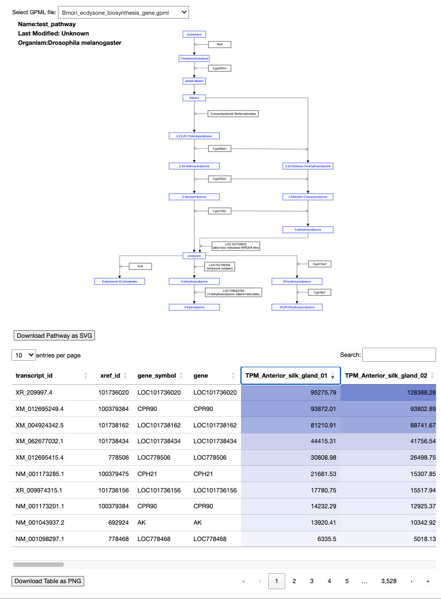
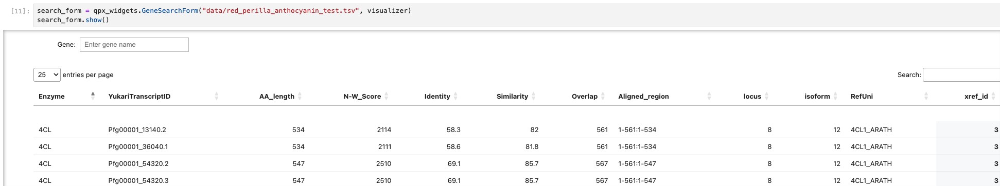

# Quest for Pathways with eXpression (QPX) 

Quest for Pathways with eXpression (QPX) is a tool that displays WikiPathways pathways and attribute tables for selected nodes in Jupyter notebook.
Open `qpx.ipynb` in a Jupyter notebook environment and use it.

## Usage

### Prerequisite

- `docker` and `docker-compose` must be installed
- Docker Desktop must be running

### Deployment of Project Data

- At least two files (GPML and expression table) are required to run QPX
- Describe the configuration for the placement of these files before building the application

#### Case1: Place local files directly into the application

- Place GPML files under `gpml/` in the project directory
- Place the expression table in `gpml/` or `data/` and rewrite the file path after starting the notebook

#### Case2: Use GitHub data repository

1. `cd` to qpx local repository and clone the data repository in the qpx repository (root)
2. If the `gpml/` directory remains in the qpx project, change the original `gpml/` to `gmpl_backup/`, etc (you can delete it)
3. Map the data repository project to volumes in `docker-compose.yml` as follows (do not delete the original `".:/home/jovyan/work"` is not deleted)

```
volumes:
　- ".:/home/jovyan/work"
　- "./{data_repo_name}/{project_name}:/home/jovyan/work/gpml"
```

4. After starting Jupyter notebook, modify the file path of the expression data as follows

```
   expression_data_path = "gpml/(file name)"
```

### Installation

```
git clone https://github.com/bonohu/qpx
cd qpx
docker compose up -d
```

After launching, you can access http://localhost:8888/lab/tree/qpx.ipynb and run each cell for visualization.
If you want to increase the number of GPML files to be visualized, place the files with the extension `.gpml` in `gpml/` directory.

After updating the local repository, follow [Updating](#updating) to rebuild the application.

### Quick Start with MyBinder

For a quick demo without local installation, you can try QPX directly in your browser using MyBinder:

[](https://mybinder.org/v2/gh/bonohu/qpx/main?urlpath=%2Fdoc%2Ftree%2Fqpx.ipynb)

Simply click the badge above or visit the following URL:
```
https://mybinder.org/v2/gh/bonohu/qpx/main?urlpath=%2Fdoc%2Ftree%2Fqpx.ipynb
```

This will launch a live Jupyter environment with QPX pre-installed. Note that MyBinder sessions are temporary and any changes will be lost when the session ends.

### Additional note on operating environment

- QPX is running on Jupyter Notebook started with docker compose.
- We have also verified that applications on the notebook start up in a Python virtual environment.
  - Only python version 3.9 or higher is supported.
  - Install Node.js 26.13.0 before building the widget extension locally. Docker and CI also use this version.

```
$ pip install jupyterlab polars # In Appli Sillicon, use "polars-lts-cpu" instead of "polars"
$ source qpx_env/bin/activate
$ cd qpx_widgets
$ jlpm install
$ jlpm run build
$ pip install -e .
$ jupyter labextension develop --overwrite .
$ cd ../
```

- Start Jupyter Lab from the project root directory

```
$ jupyter lab
```


# About Major Components

The following two components are both described in `qpx_widgets/qpx_widgets/visualizers.py`

### GpmlD3Visualizer

- The main component of the visualization
- It consists of the following two elements

1. Pathway diagram
2. Gene information table (including expression levels)

   - Update: `expression_columns_index` now accepts `int`, `list`, or `tuple`.
   - When a single `int` is given, the same column index is used for all expression tables.
   - When a `list` or `tuple` is given, each value is applied to each expression table in order. This allows different relation-key column positions to be specified for multiple expression tables.

   Example:
   ```python
   visualizer = qpx_widgets.GpmlD3Visualizer(
       expression_data_path=["data/a.tsv", "data/b.tsv"],
       expression_columns_index=[4, 6]
   )
   ```

   - The expression amount part is colored as a heatmap, but if you want to change this color, just change the following RGB values in the `qpx_widgets/src/widget.ts`.

   ```
         const highlightColor = [131, 146, 219];
         const defaultColor = [250, 250, 255];
   ```

   - The color of the heatmap changes from `defaultColor` to `highlightColor` according to the expression value.

Screen shot of GpmlD3Visualizer:


### GeneSearchForm

- Component for searching gene information
- It consists of two components: a search box and a gene information table.
- By passing an instance of Gpml3DVisualizer at initialization, the corresponding node of Gpml3DVisualizer can be made selected when a row in the gene information table is clicked.
- The search box portion will be expanded to a more flexible query interface in the future.

- Example usage:
```
search_form = qpx_widgets.GeneSearchForm("data/red_perilla_anthocyanin_test.tsv", visualizer)
search_form.show()
```


# Todo

- Fixed a bug that table is not displayed when selecting a node in Anaconda environment.

## Updating

Run these commands from the project root after updating the local repository.

| Option | Effect |
|---|---|
| `build --no-cache` | Rebuilds the image without using the build cache. |
| `up --force-recreate` | Recreates containers even if the image and configuration have not changed. It does not rebuild the image. |
| `up --renew-anon-volumes` | Creates fresh anonymous volumes instead of reusing those from existing containers. |

For normal application updates, including TypeScript or CSS changes:

```sh
docker compose build notebook
docker compose up -d --force-recreate --renew-anon-volumes notebook
```

QPX stores `node_modules` and built `labextension` files in anonymous volumes. Renew them to prevent old build outputs from hiding the updated files in the image. Reload the Notebook page and restart its kernel after updating.

If you suspect stale build cache, use the same procedure with `--no-cache`:

```sh
docker compose build --no-cache notebook
docker compose up -d --force-recreate --renew-anon-volumes notebook
```

`--no-cache` is normally unnecessary: Docker detects changed source files. If you have already run `docker compose down`, the containers have been removed, so `--force-recreate` is unnecessary. Changes only to GPML or TSV files in the mounted project directory do not require a rebuild; rerun the relevant Notebook cells to load them.
